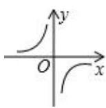
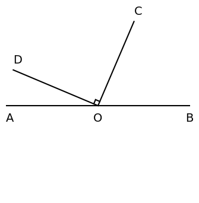

# AVP0846 — Single visual target

MV-MATH:963_1 / DynaMath:83 · different type · Mathematical roles of symbols

## Shared or similar visual information

The letter O

## Evidence locations

- Left image: O at the axes' intersection between the separated branches
- Right image: O at the common endpoint of the rays forming the marked right angle

## Mathematical meanings

Left image: The symbol "O" marks the origin at the intersection of the coordinate axes. Right image: The symbol "O" names the common point of the rays that form an angle.

## Same mathematical meanings

no

## Rationales

The left occurrence is O at the axes' intersection between the separated branches. The right occurrence is O at the common endpoint of the rays forming the marked right angle. The left placement shows that the symbol marks the origin at the intersection of the coordinate axes, while the right placement shows that it names the common point of the rays that form an angle.

Only the selected target is annotated. AI visual-review draft; not independently double-annotated by humans.
