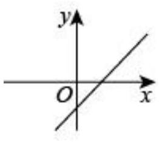
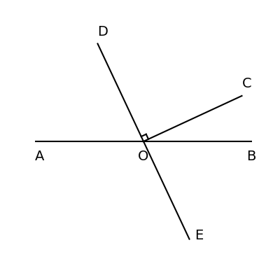

# AVP0848 — Single visual target

MV-MATH:994_1 / DynaMath:197 · different type · Mathematical roles of symbols

## Shared or similar visual information

The letter O

## Evidence locations

- Left image: O just left of the vertical axis at the horizontal axis
- Right image: O at the crossing of AB and DE beside the angle marker

## Mathematical meanings

Left image: The symbol "O" marks the origin at the intersection of the coordinate axes. Right image: The symbol "O" names the common point of the rays that form an angle.

## Same mathematical meanings

no

## Rationales

The left occurrence is O just left of the vertical axis at the horizontal axis. The right occurrence is O at the crossing of AB and DE beside the angle marker. The left placement shows that the symbol marks the origin at the intersection of the coordinate axes, while the right placement shows that it names the common point of the rays that form an angle.

Only the selected target is annotated. AI visual-review draft; not independently double-annotated by humans.
