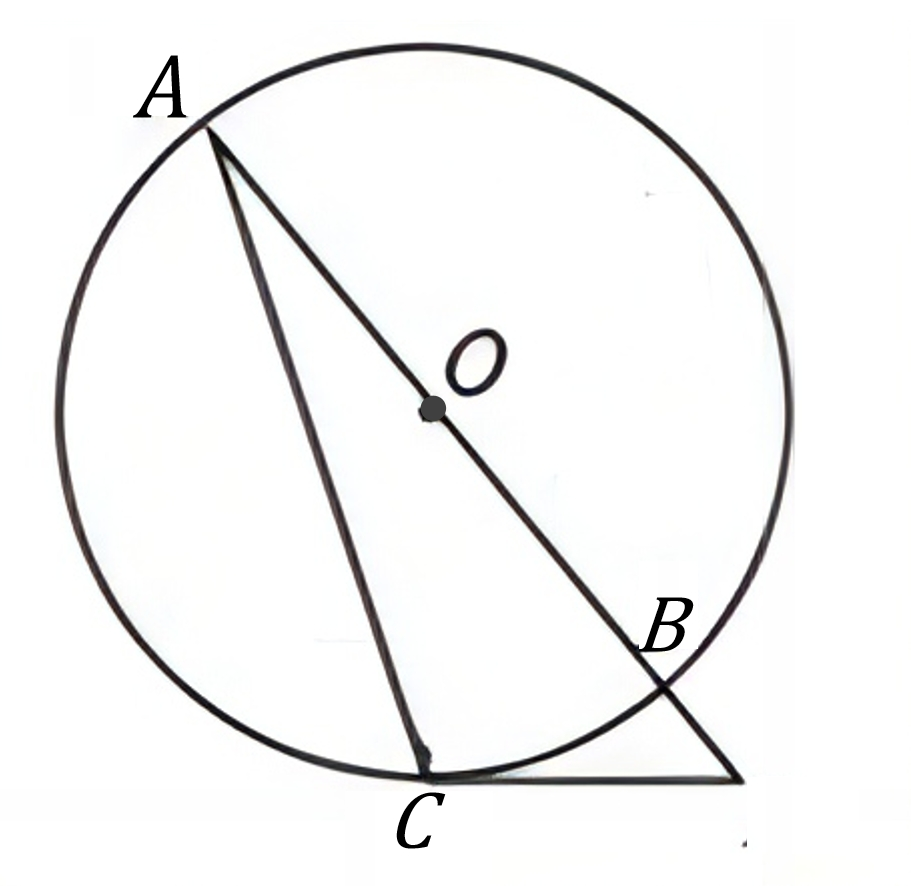
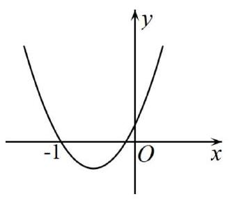

# AVP0849 — Single visual target

DynaMath:81 / MV-MATH:85_1 · different type · Mathematical roles of symbols

## Shared or similar visual information

The letter O

## Evidence locations

- Left image: O beside the black dot on the diameter through A and B
- Right image: O below and to the right of the coordinate axes' crossing

## Mathematical meanings

Left image: The symbol "O" marks the center of the indicated circle. Right image: The symbol "O" marks the origin at the intersection of the coordinate axes.

## Same mathematical meanings

no

## Rationales

The left occurrence is O beside the black dot on the diameter through A and B. The right occurrence is O below and to the right of the coordinate axes' crossing. The left placement shows that the symbol marks the center of the indicated circle, while the right placement shows that it marks the origin at the intersection of the coordinate axes.

Only the selected target is annotated. AI visual-review draft; not independently double-annotated by humans.
