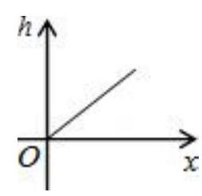
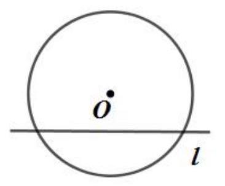

# AVP0850 — Single visual target

MV-MATH:1063_1 / MV-MATH:227_1 · different type · Mathematical roles of symbols

## Shared or similar visual information

The letter O

## Evidence locations

- Left image: O at the meeting of the horizontal x and vertical h axes
- Right image: O beneath the dot at the center, above the horizontal chord

## Mathematical meanings

Left image: The symbol "O" marks the origin at the intersection of the coordinate axes. Right image: The symbol "O" marks the center of the indicated circle.

## Same mathematical meanings

no

## Rationales

The left occurrence is O at the meeting of the horizontal x and vertical h axes. The right occurrence is O beneath the dot at the center, above the horizontal chord. The left placement shows that the symbol marks the origin at the intersection of the coordinate axes, while the right placement shows that it marks the center of the indicated circle.

Only the selected target is annotated. AI visual-review draft; not independently double-annotated by humans.
