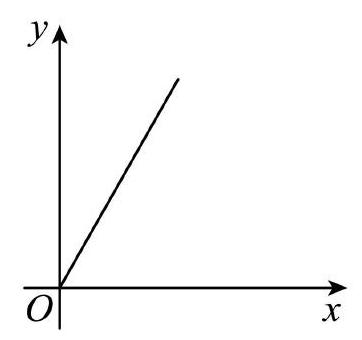
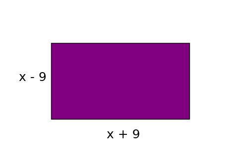

# AVP0851 — Single visual target

MV-MATH:1047_1 / DynaMath:66 · different type · Mathematical roles of symbols

## Shared or similar visual information

The letter x

## Evidence locations

- Left image: x at the right-pointing arrow below the plotted ray
- Right image: x in the expression x - 9 beside the purple rectangle

## Mathematical meanings

Left image: The symbol "x" labels the indicated coordinate axis. Right image: The symbol "x" denotes a length or a variable in the indicated length expression.

## Same mathematical meanings

no

## Rationales

The left occurrence is x at the right-pointing arrow below the plotted ray. The right occurrence is x in the expression x - 9 beside the purple rectangle. The left placement shows that the symbol labels the indicated coordinate axis, while the right placement shows that it denotes a length or a variable in the indicated length expression.

Only the selected target is annotated. AI visual-review draft; not independently double-annotated by humans.
