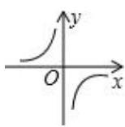
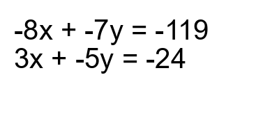

# AVP0852 — Single visual target

MV-MATH:963_1 / DynaMath:492 · different type · Mathematical roles of symbols

## Shared or similar visual information

The letter x

## Evidence locations

- Left image: x beside the horizontal arrow over the lower-right branch
- Right image: x in the leading term of each of the two simultaneous equations

## Mathematical meanings

Left image: The symbol "x" labels the indicated coordinate axis. Right image: The symbol "x" denotes one of the unknown numbers constrained by the equations.

## Same mathematical meanings

no

## Rationales

The left occurrence is x beside the horizontal arrow over the lower-right branch. The right occurrence is x in the leading term of each of the two simultaneous equations. The left placement shows that the symbol labels the indicated coordinate axis, while the right placement shows that it denotes one of the unknown numbers constrained by the equations.

Only the selected target is annotated. AI visual-review draft; not independently double-annotated by humans.
