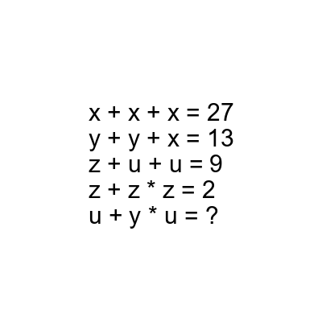
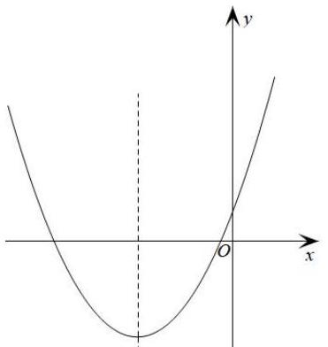

# AVP0853 — Single visual target

DynaMath:16 / MV-MATH:634_1 · different type · Mathematical roles of symbols

## Shared or similar visual information

The letter x

## Evidence locations

- Left image: x repeated as all three addends in the first equation
- Right image: x at the arrow on the solid horizontal line

## Mathematical meanings

Left image: The symbol "x" denotes one of the unknown numbers constrained by the equations. Right image: The symbol "x" labels the indicated coordinate axis.

## Same mathematical meanings

no

## Rationales

The left occurrence is x repeated as all three addends in the first equation. The right occurrence is x at the arrow on the solid horizontal line. The left placement shows that the symbol denotes one of the unknown numbers constrained by the equations, while the right placement shows that it labels the indicated coordinate axis.

Only the selected target is annotated. AI visual-review draft; not independently double-annotated by humans.
