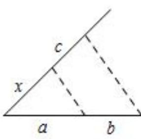
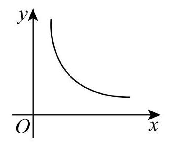

# AVP0855 — Single visual target

MV-MATH:505_1 / MV-MATH:78_1 · different type · Mathematical roles of symbols

## Shared or similar visual information

The letter x

## Evidence locations

- Left image: x beside the first slanted segment from the lower-left corner
- Right image: x below the horizontal arrow beneath the decreasing curve

## Mathematical meanings

Left image: The symbol "x" denotes a length or a variable in the indicated length expression. Right image: The symbol "x" labels the indicated coordinate axis.

## Same mathematical meanings

no

## Rationales

The left occurrence is x beside the first slanted segment from the lower-left corner. The right occurrence is x below the horizontal arrow beneath the decreasing curve. The left placement shows that the symbol denotes a length or a variable in the indicated length expression, while the right placement shows that it labels the indicated coordinate axis.

Only the selected target is annotated. AI visual-review draft; not independently double-annotated by humans.
