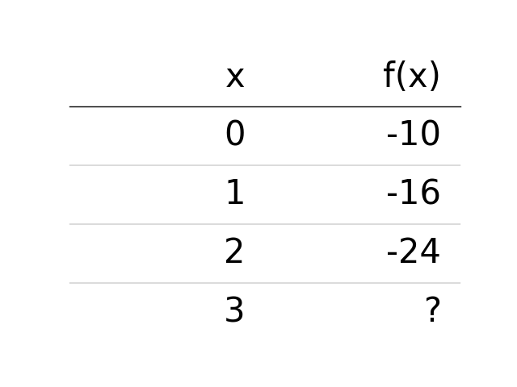
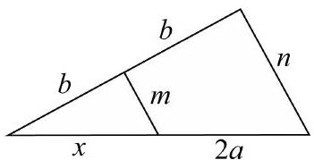

# AVP0856 — Single visual target

DynaMath:63 / MV-MATH:527_1 · different type · Mathematical roles of symbols

## Shared or similar visual information

The letter x

## Evidence locations

- Left image: x atop the column with inputs 0 through 3
- Right image: x under the left part of the triangle base

## Mathematical meanings

Left image: The symbol "x" denotes the independent input to the function. Right image: The symbol "x" denotes a length or a variable in the indicated length expression.

## Same mathematical meanings

no

## Rationales

The left occurrence is x atop the column with inputs 0 through 3. The right occurrence is x under the left part of the triangle base. The left placement shows that the symbol denotes the independent input to the function, while the right placement shows that it denotes a length or a variable in the indicated length expression.

Only the selected target is annotated. AI visual-review draft; not independently double-annotated by humans.
