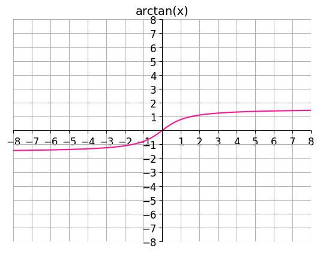
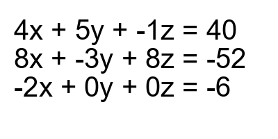

# AVP0857 — Single visual target

DynaMath:118 / DynaMath:493 · different type · Mathematical roles of symbols

## Shared or similar visual information

The letter x

## Evidence locations

- Left image: x inside arctan(x) above the curve
- Right image: x in the first term of all three equations

## Mathematical meanings

Left image: The symbol "x" denotes the independent input to the function. Right image: The symbol "x" denotes one of the unknown numbers constrained by the equations.

## Same mathematical meanings

no

## Rationales

The left occurrence is x inside arctan(x) above the curve. The right occurrence is x in the first term of all three equations. The left placement shows that the symbol denotes the independent input to the function, while the right placement shows that it denotes one of the unknown numbers constrained by the equations.

Only the selected target is annotated. AI visual-review draft; not independently double-annotated by humans.
