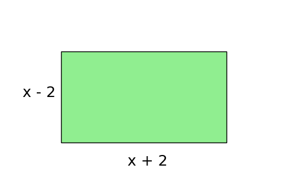
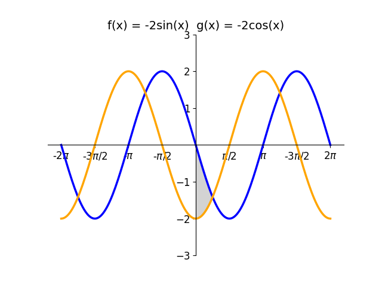

# AVP0858 — Single visual target

DynaMath:65 / DynaMath:144 · different type · Mathematical roles of symbols

## Shared or similar visual information

The letter x

## Evidence locations

- Left image: x in the expression x + 2 under the green rectangle
- Right image: x in the sine argument in the first function definition above the graph

## Mathematical meanings

Left image: The symbol "x" denotes a length or a variable in the indicated length expression. Right image: The symbol "x" denotes the independent input to the function.

## Same mathematical meanings

no

## Rationales

The left occurrence is x in the expression x + 2 under the green rectangle. The right occurrence is x in the sine argument in the first function definition above the graph. The left placement shows that the symbol denotes a length or a variable in the indicated length expression, while the right placement shows that it denotes the independent input to the function.

Only the selected target is annotated. AI visual-review draft; not independently double-annotated by humans.
