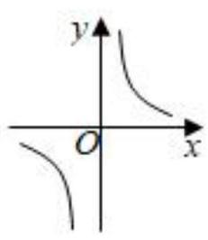
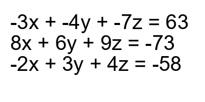

# AVP0860 — Single visual target

MV-MATH:1080_1 / DynaMath:494 · different type · Mathematical roles of symbols

## Shared or similar visual information

The letter y

## Evidence locations

- Left image: y next to the upward arrow between the two branches
- Right image: y in the second term on each line of the printed system

## Mathematical meanings

Left image: The symbol "y" labels the indicated coordinate axis. Right image: The symbol "y" denotes one of the unknown numbers constrained by the equations.

## Same mathematical meanings

no

## Rationales

The left occurrence is y next to the upward arrow between the two branches. The right occurrence is y in the second term on each line of the printed system. The left placement shows that the symbol labels the indicated coordinate axis, while the right placement shows that it denotes one of the unknown numbers constrained by the equations.

Only the selected target is annotated. AI visual-review draft; not independently double-annotated by humans.
