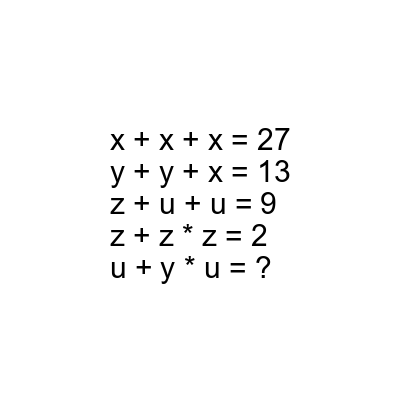
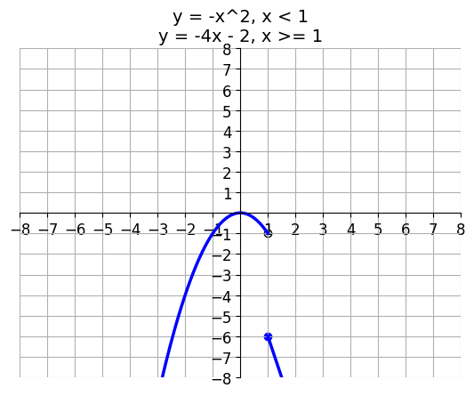

# AVP0861 — Single visual target

DynaMath:16 / DynaMath:86 · different type · Mathematical roles of symbols

## Shared or similar visual information

The letter y

## Evidence locations

- Left image: y repeated in the second equation of the printed system
- Right image: y at the start of each expression defining the two plotted branches

## Mathematical meanings

Left image: The symbol "y" denotes one of the unknown numbers constrained by the equations. Right image: The symbol "y" denotes the dependent value defined by the displayed equation.

## Same mathematical meanings

no

## Rationales

The left occurrence is y repeated in the second equation of the printed system. The right occurrence is y at the start of each expression defining the two plotted branches. The left placement shows that the symbol denotes one of the unknown numbers constrained by the equations, while the right placement shows that it denotes the dependent value defined by the displayed equation.

Only the selected target is annotated. AI visual-review draft; not independently double-annotated by humans.
