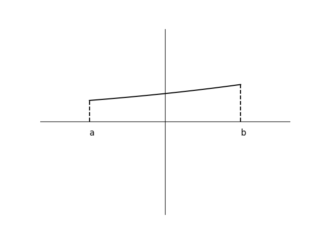
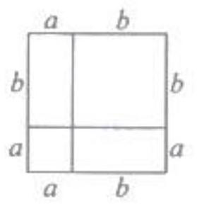

# AVP0862 — Single visual target

DynaMath:203 / MV-MATH:68_1 · different type · Mathematical roles of symbols

## Shared or similar visual information

The letter a

## Evidence locations

- Left image: a beneath the left dashed drop to the horizontal axis
- Right image: a above the shorter left part of the top edge

## Mathematical meanings

Left image: The symbol "a" denotes the horizontal coordinate of the indicated interval endpoint. Right image: The symbol "a" denotes a length or a variable in the indicated length expression.

## Same mathematical meanings

no

## Rationales

The left occurrence is a beneath the left dashed drop to the horizontal axis. The right occurrence is a above the shorter left part of the top edge. The left placement shows that the symbol denotes the horizontal coordinate of the indicated interval endpoint, while the right placement shows that it denotes a length or a variable in the indicated length expression.

Only the selected target is annotated. AI visual-review draft; not independently double-annotated by humans.
