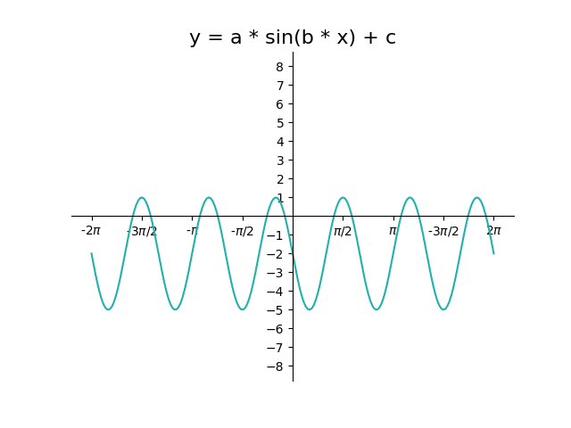
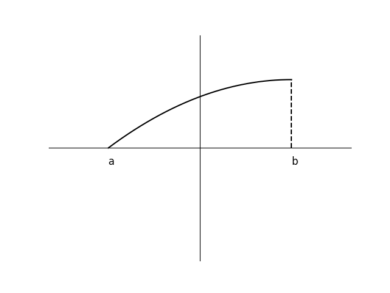

# AVP0863 — Single visual target

DynaMath:345 / DynaMath:204 · same type · Mathematical roles of symbols

## Shared or similar visual information

The letter a

## Evidence locations

- Left image: a immediately before the multiplication sign and sine
- Right image: a below the left endpoint of the increasing curve

## Mathematical meanings

Left image: The symbol "a" denotes the multiplier that controls the wave amplitude. Right image: The symbol "a" denotes the horizontal coordinate of the indicated interval endpoint.

## Same mathematical meanings

no

## Rationales

The left occurrence is a immediately before the multiplication sign and sine. The right occurrence is a below the left endpoint of the increasing curve. The left placement shows that the symbol denotes the multiplier that controls the wave amplitude, while the right placement shows that it denotes the horizontal coordinate of the indicated interval endpoint.

Only the selected target is annotated. AI visual-review draft; not independently double-annotated by humans.
