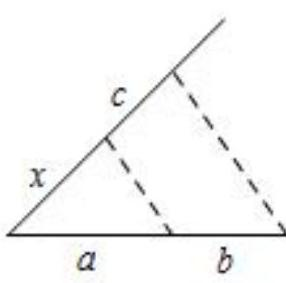
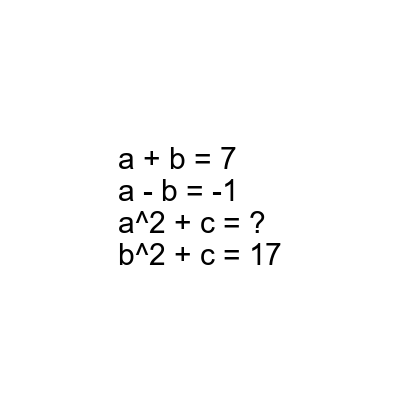

# AVP0864 — Single visual target

MV-MATH:505_1 / DynaMath:499 · different type · Mathematical roles of symbols

## Shared or similar visual information

The letter a

## Evidence locations

- Left image: a below the left part of the triangle base
- Right image: a in a + b = 7 and a - b = -1

## Mathematical meanings

Left image: The symbol "a" denotes a length or a variable in the indicated length expression. Right image: The symbol "a" denotes one of the unknown numbers constrained by the equations.

## Same mathematical meanings

no

## Rationales

The left occurrence is a below the left part of the triangle base. The right occurrence is a in a + b = 7 and a - b = -1. The left placement shows that the symbol denotes a length or a variable in the indicated length expression, while the right placement shows that it denotes one of the unknown numbers constrained by the equations.

Only the selected target is annotated. AI visual-review draft; not independently double-annotated by humans.
