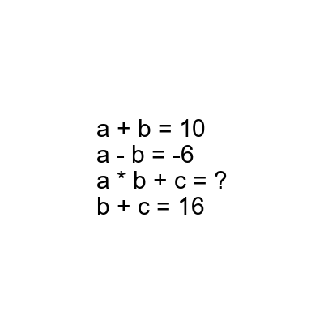
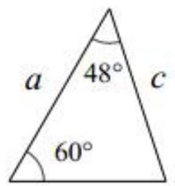

# AVP0865 — Single visual target

DynaMath:495 / MV-MATH:973_1 · different type · Mathematical roles of symbols

## Shared or similar visual information

The letter a

## Evidence locations

- Left image: a in the equations a + b = 10 and a - b = -6
- Right image: a beside the left side of the triangle

## Mathematical meanings

Left image: The symbol "a" denotes one of the unknown numbers constrained by the equations. Right image: The symbol "a" denotes a length or a variable in the indicated length expression.

## Same mathematical meanings

no

## Rationales

The left occurrence is a in the equations a + b = 10 and a - b = -6. The right occurrence is a beside the left side of the triangle. The left placement shows that the symbol denotes one of the unknown numbers constrained by the equations, while the right placement shows that it denotes a length or a variable in the indicated length expression.

Only the selected target is annotated. AI visual-review draft; not independently double-annotated by humans.
