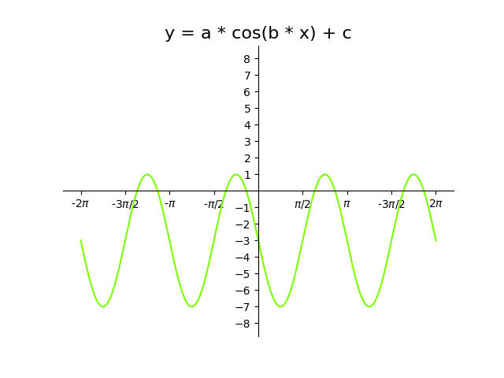
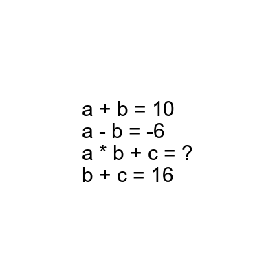

# AVP0866 — Single visual target

DynaMath:346 / DynaMath:495 · different type · Mathematical roles of symbols

## Shared or similar visual information

The letter a

## Evidence locations

- Left image: a immediately before the multiplication sign and cosine
- Right image: a in the equations a + b = 10 and a - b = -6

## Mathematical meanings

Left image: The symbol "a" denotes the multiplier that controls the wave amplitude. Right image: The symbol "a" denotes one of the unknown numbers constrained by the equations.

## Same mathematical meanings

no

## Rationales

The left occurrence is a immediately before the multiplication sign and cosine. The right occurrence is a in the equations a + b = 10 and a - b = -6. The left placement shows that the symbol denotes the multiplier that controls the wave amplitude, while the right placement shows that it denotes one of the unknown numbers constrained by the equations.

Only the selected target is annotated. AI visual-review draft; not independently double-annotated by humans.
