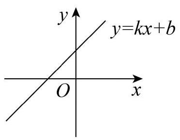
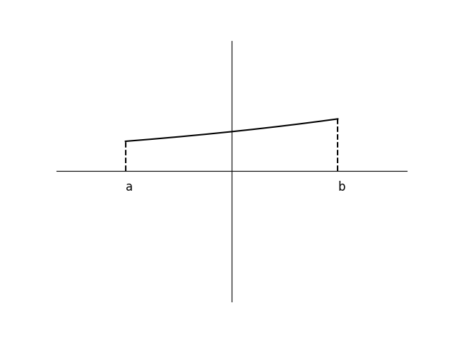

# AVP0867 — Single visual target

MV-MATH:950_1 / DynaMath:203 · same type · Mathematical roles of symbols

## Shared or similar visual information

The letter b

## Evidence locations

- Left image: b as the standalone term in y = kx + b
- Right image: b under the right dashed projection to the axis

## Mathematical meanings

Left image: The symbol "b" denotes the constant term and vertical intercept of the straight line. Right image: The symbol "b" denotes the horizontal coordinate of the indicated interval endpoint.

## Same mathematical meanings

no

## Rationales

The left occurrence is b as the standalone term in y = kx + b. The right occurrence is b under the right dashed projection to the axis. The left placement shows that the symbol denotes the constant term and vertical intercept of the straight line, while the right placement shows that it denotes the horizontal coordinate of the indicated interval endpoint.

Only the selected target is annotated. AI visual-review draft; not independently double-annotated by humans.
