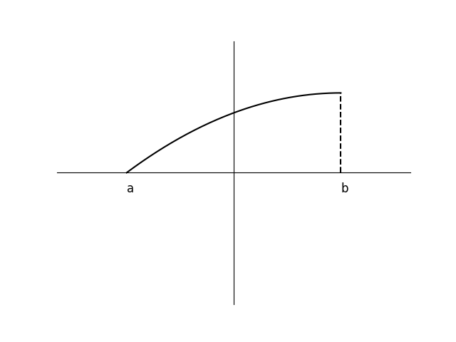
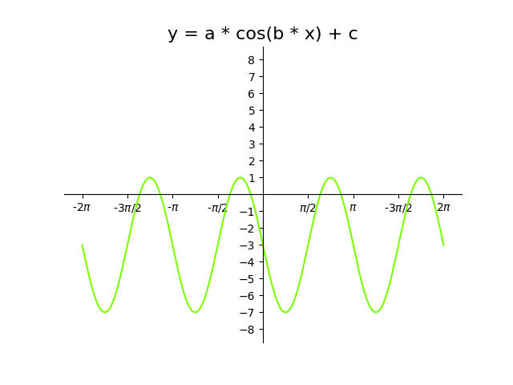

# AVP0868 — Single visual target

DynaMath:204 / DynaMath:346 · same type · Mathematical roles of symbols

## Shared or similar visual information

The letter b

## Evidence locations

- Left image: b below the right dashed projection from the curve
- Right image: b multiplying x inside the cosine argument

## Mathematical meanings

Left image: The symbol "b" denotes the horizontal coordinate of the indicated interval endpoint. Right image: The symbol "b" denotes the coefficient of the input in the trigonometric argument.

## Same mathematical meanings

no

## Rationales

The left occurrence is b below the right dashed projection from the curve. The right occurrence is b multiplying x inside the cosine argument. The left placement shows that the symbol denotes the horizontal coordinate of the indicated interval endpoint, while the right placement shows that it denotes the coefficient of the input in the trigonometric argument.

Only the selected target is annotated. AI visual-review draft; not independently double-annotated by humans.
