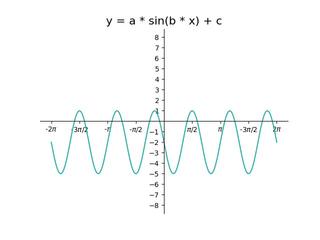
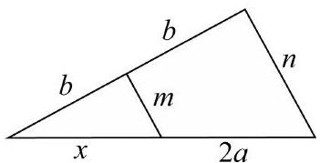

# AVP0869 — Single visual target

DynaMath:345 / MV-MATH:527_1 · different type · Mathematical roles of symbols

## Shared or similar visual information

The letter b

## Evidence locations

- Left image: b multiplying x inside the sine argument
- Right image: b printed on the two parts of the left slanted side

## Mathematical meanings

Left image: The symbol "b" denotes the coefficient of the input in the trigonometric argument. Right image: The symbol "b" denotes a length or a variable in the indicated length expression.

## Same mathematical meanings

no

## Rationales

The left occurrence is b multiplying x inside the sine argument. The right occurrence is b printed on the two parts of the left slanted side. The left placement shows that the symbol denotes the coefficient of the input in the trigonometric argument, while the right placement shows that it denotes a length or a variable in the indicated length expression.

Only the selected target is annotated. AI visual-review draft; not independently double-annotated by humans.
