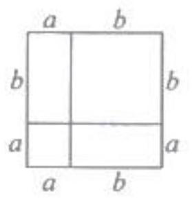
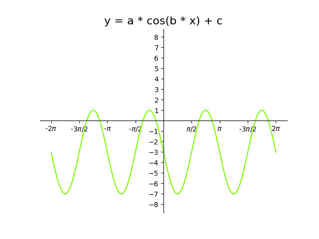

# AVP0870 — Single visual target

MV-MATH:68_1 / DynaMath:346 · different type · Mathematical roles of symbols

## Shared or similar visual information

The letter b

## Evidence locations

- Left image: b above the longer right part of the top edge
- Right image: b multiplying x inside the cosine argument

## Mathematical meanings

Left image: The symbol "b" denotes a length or a variable in the indicated length expression. Right image: The symbol "b" denotes the coefficient of the input in the trigonometric argument.

## Same mathematical meanings

no

## Rationales

The left occurrence is b above the longer right part of the top edge. The right occurrence is b multiplying x inside the cosine argument. The left placement shows that the symbol denotes a length or a variable in the indicated length expression, while the right placement shows that it denotes the coefficient of the input in the trigonometric argument.

Only the selected target is annotated. AI visual-review draft; not independently double-annotated by humans.
