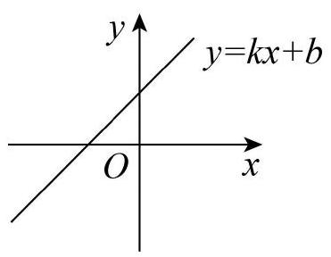
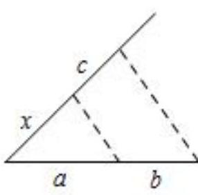

# AVP0871 — Single visual target

MV-MATH:950_1 / MV-MATH:505_1 · different type · Mathematical roles of symbols

## Shared or similar visual information

The letter b

## Evidence locations

- Left image: b as the standalone term in y = kx + b
- Right image: b below the right part of the triangle base

## Mathematical meanings

Left image: The symbol "b" denotes the constant term and vertical intercept of the straight line. Right image: The symbol "b" denotes a length or a variable in the indicated length expression.

## Same mathematical meanings

no

## Rationales

The left occurrence is b as the standalone term in y = kx + b. The right occurrence is b below the right part of the triangle base. The left placement shows that the symbol denotes the constant term and vertical intercept of the straight line, while the right placement shows that it denotes a length or a variable in the indicated length expression.

Only the selected target is annotated. AI visual-review draft; not independently double-annotated by humans.
