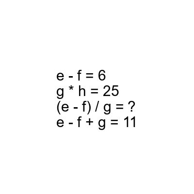
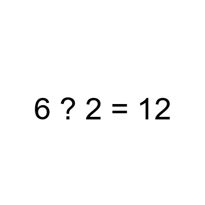

# AVP0873 — Single visual target

DynaMath:496 / DynaMath:500 · same type · Mathematical roles of symbols

## Shared or similar visual information

The question mark (?)

## Evidence locations

- Left image: ? after the equals sign on the line with (e - f) / g
- Right image: ? between 6 and 2 on the left of the equals sign

## Mathematical meanings

Left image: The symbol "?" stands for the missing numerical output or result. Right image: The symbol "?" stands for the arithmetic operation to insert between two operands.

## Same mathematical meanings

no

## Rationales

The left occurrence is ? after the equals sign on the line with (e - f) / g. The right occurrence is ? between 6 and 2 on the left of the equals sign. The left placement shows that the symbol stands for the missing numerical output or result, while the right placement shows that it stands for the arithmetic operation to insert between two operands.

Only the selected target is annotated. AI visual-review draft; not independently double-annotated by humans.
