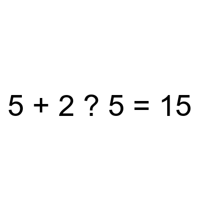
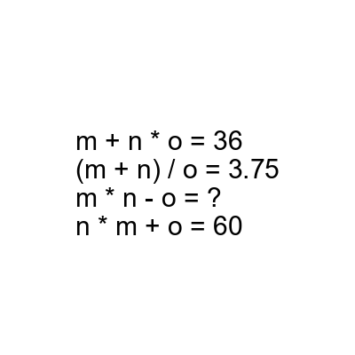

# AVP0874 — Single visual target

DynaMath:501 / DynaMath:498 · same type · Mathematical roles of symbols

## Shared or similar visual information

The question mark (?)

## Evidence locations

- Left image: ? between 2 and 5 in the expression
- Right image: ? after the equals sign in m * n - o = ?

## Mathematical meanings

Left image: The symbol "?" stands for the arithmetic operation to insert between two operands. Right image: The symbol "?" stands for the missing numerical output or result.

## Same mathematical meanings

no

## Rationales

The left occurrence is ? between 2 and 5 in the expression. The right occurrence is ? after the equals sign in m * n - o = ?. The left placement shows that the symbol stands for the arithmetic operation to insert between two operands, while the right placement shows that it stands for the missing numerical output or result.

Only the selected target is annotated. AI visual-review draft; not independently double-annotated by humans.
