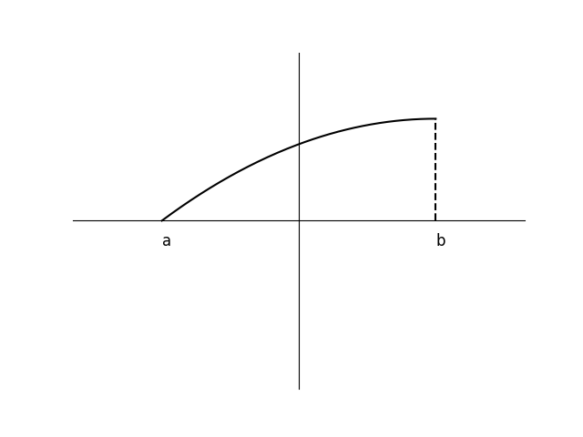

# AVP0877 — Single visual target

DynaMath:204 / VisioMath:181_A · same type · Mathematical roles of graphical elements

[Right image in official archive](https://raw.githubusercontent.com/Nefefilibata/VisioMath/4a912153e110001da261917902e1d3cc163b7c6a/data/images.zip) · `images/181_A.jpg`

## Shared or similar visual information

A vertical dashed segment joining a plotted trace to the horizontal axis.

## Evidence locations

- Left image: The vertical dashed guide from the curve down to the position labeled b.
- Right image: The vertical dashed segment below the curve peak at x=1.

## Mathematical meanings

Left image: A guide projecting a selected position on the graph down to its horizontal input coordinate. Right image: A guide projecting a selected position on the graph down to its horizontal input coordinate.

## Same mathematical meanings

yes

## Rationales

Each broken segment aligns a chosen position on a graph with its horizontal input. The guide is separate from the solid trace that carries the plotted values.

Only the selected target is annotated. AI visual-review draft; not independently double-annotated by humans.
