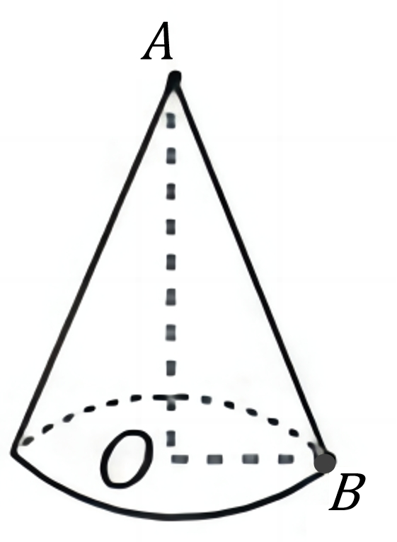

# AVP0884 — Single visual target

VisioMath:626_A / DynaMath:8 · different type · Mathematical roles of graphical elements

[Left image in official archive](https://raw.githubusercontent.com/Nefefilibata/VisioMath/4a912153e110001da261917902e1d3cc163b7c6a/data/images.zip) · `images/626_A.jpg`

## Shared or similar visual information

A vertical dashed segment inside a mathematical diagram.

## Evidence locations

- Left image: The dotted vertical line beneath the upper end of the graph at x=6.
- Right image: The dashed segment descending from A to O in the cone.

## Mathematical meanings

Left image: A guide projecting a selected position on the graph down to its horizontal input coordinate. Right image: The height of the solid, drawn as an interior segment from its apex toward the base.

## Same mathematical meanings

no

## Rationales

The guide reaches an input tick on an axis. The segment inside the solid joins its apex to its base level and represents a geometric height.

Only the selected target is annotated. AI visual-review draft; not independently double-annotated by humans.
