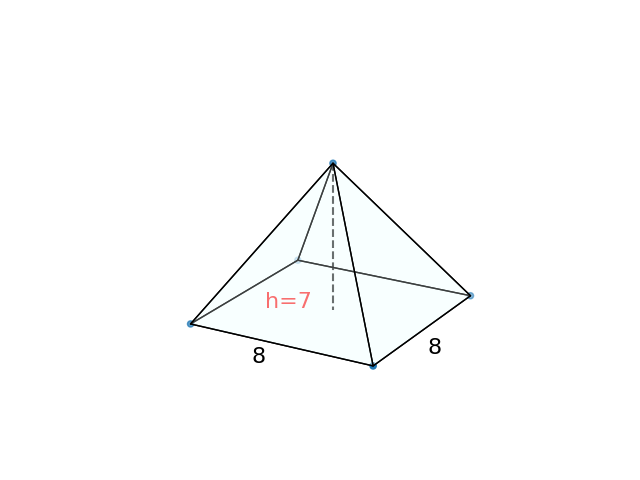

# AVP0885 — Single visual target

DynaMath:129 / VisioMath:1300_A · different type · Mathematical roles of graphical elements

[Right image in official archive](https://raw.githubusercontent.com/Nefefilibata/VisioMath/4a912153e110001da261917902e1d3cc163b7c6a/data/images.zip) · `images/1300_A.jpg`

## Shared or similar visual information

A vertical dashed segment inside a mathematical diagram.

## Evidence locations

- Left image: The dashed segment descending from the pyramid apex beside the label h=7.
- Right image: The dotted line projecting the end of the curve to t=1.5.

## Mathematical meanings

Left image: The height of the solid, drawn as an interior segment from its apex toward the base. Right image: A guide projecting a selected position on the graph down to its horizontal input coordinate.

## Same mathematical meanings

no

## Rationales

The guide reaches an input tick on an axis. The segment inside the solid joins its apex to its base level and represents a geometric height.

Only the selected target is annotated. AI visual-review draft; not independently double-annotated by humans.
