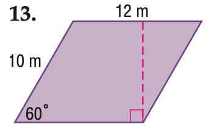

# AVP0889 — Single visual target

MathVista:822 / VisioMath:1703_A · different type · Mathematical roles of graphical elements

[Right image in official archive](https://raw.githubusercontent.com/Nefefilibata/VisioMath/4a912153e110001da261917902e1d3cc163b7c6a/data/images.zip) · `images/1703_A.jpg`

## Shared or similar visual information

A vertical dashed segment meeting a horizontal baseline.

## Evidence locations

- Left image: The dashed magenta height from the top edge to a right-angle box on the bottom edge.
- Right image: The dashed vertical guide beneath the left corner of the plateau at x=4.

## Mathematical meanings

Left image: An auxiliary segment dropping perpendicularly to a geometric baseline. Right image: A guide projecting a selected position on the graph down to its horizontal input coordinate.

## Same mathematical meanings

no

## Rationales

The plotted guide reads a horizontal input coordinate. The square at the foot of the other segment identifies a perpendicular construction in a finite geometric figure.

Only the selected target is annotated. AI visual-review draft; not independently double-annotated by humans.
