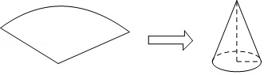

# AVP0893 — Single visual target

MathVista:33 / VisioMath:59_A · same type · Mathematical roles of graphical elements

[Right image in official archive](https://raw.githubusercontent.com/Nefefilibata/VisioMath/4a912153e110001da261917902e1d3cc163b7c6a/data/images.zip) · `images/59_A.jpg`

## Shared or similar visual information

A dashed curve.

## Evidence locations

- Left image: The curved dashed arc at the rear of the cone base.
- Right image: The dashed arc on the back half of the right cylinder end.

## Mathematical meanings

Left image: The dashed arc draws the hidden part of the circular cone base. Right image: The dashed arc represents the hidden portion of the rim of the cylinder’s right end.

## Same mathematical meanings

yes

## Rationales

In both images the feature shows the occluded part of the circular rim of a solid. The curved dashed arc at the rear of the cone base. The dashed arc on the back half of the right cylinder end.

Only the selected target is annotated. AI visual-review draft; not independently double-annotated by humans.
