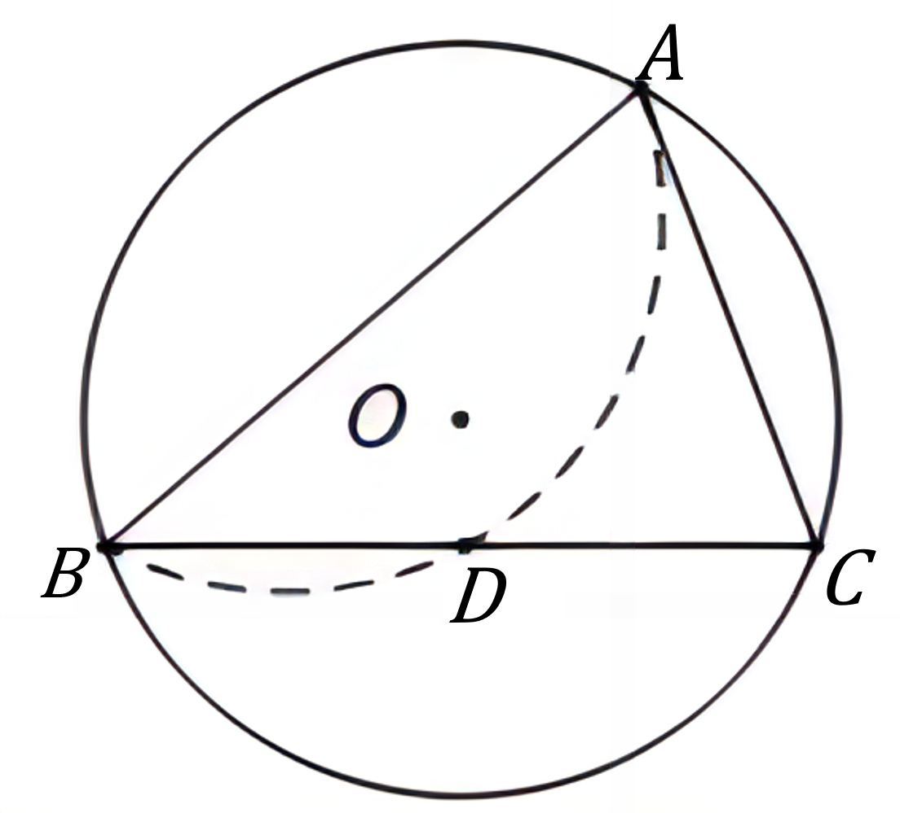

# AVP0902 — Single visual target

VisioMath:349_A / DynaMath:76 · different type · Mathematical roles of graphical elements

[Left image in official archive](https://raw.githubusercontent.com/Nefefilibata/VisioMath/4a912153e110001da261917902e1d3cc163b7c6a/data/images.zip) · `images/349_A.jpg`

## Shared or similar visual information

A curved auxiliary stroke rendered with dashes or as a compass arc.

## Evidence locations

- Left image: The dashed arc behind the front half of the lower cylinder rim.
- Right image: The dashed internal arc from B through D toward A inside the surrounding circle.

## Mathematical meanings

Left image: The occluded rear portion of a circular base rim in a solid drawing. Right image: A construction arc used to mark or locate a point within a planar geometric construction.

## Same mathematical meanings

no

## Rationales

The rear rim continues a three-dimensional circular edge behind the near surface. The compass-style arc belongs to a planar construction and locates a geometric position.

Only the selected target is annotated. AI visual-review draft; not independently double-annotated by humans.
