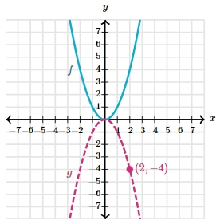

# AVP0905 — Single visual target

MathVerse:571 / VisioMath:1531_A · different type · Mathematical roles of graphical elements

[Right image in official archive](https://raw.githubusercontent.com/Nefefilibata/VisioMath/4a912153e110001da261917902e1d3cc163b7c6a/data/images.zip) · `images/1531_A.jpg`

## Shared or similar visual information

A curved dashed stroke.

## Evidence locations

- Left image: The magenta dashed downward-opening graph labeled g.
- Right image: The rear dashed arc of the bottom elliptical outline.

## Mathematical meanings

Left image: A function trace drawn with dashes to distinguish it from a second trace. Right image: The occluded rear portion of a circular base rim in a solid drawing.

## Same mathematical meanings

no

## Rationales

The ellipse uses dashes for the hidden part of a solid rim. The named graph uses a dashed stroke as the visible trace of a function.

Only the selected target is annotated. AI visual-review draft; not independently double-annotated by humans.
