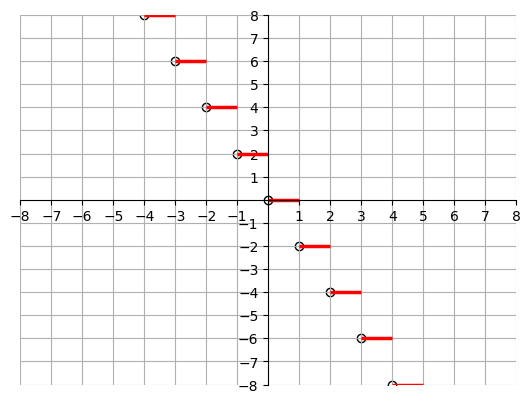

# AVP0909 — Single visual target

DynaMath:148 / VisioMath:591_A · same type · Mathematical roles of graphical elements

[Right image in official archive](https://raw.githubusercontent.com/Nefefilibata/VisioMath/4a912153e110001da261917902e1d3cc163b7c6a/data/images.zip) · `images/591_A.jpg`

## Shared or similar visual information

A hollow circular marker interrupting or ending a graph trace.

## Evidence locations

- Left image: The hollow circle at the left end of the red horizontal segment at y=2.
- Right image: The hollow circle where the rising line meets the origin.

## Mathematical meanings

Left image: An open point excluded from the displayed curve or branch. Right image: An open point excluded from the displayed curve or branch.

## Same mathematical meanings

yes

## Rationales

Each hollow mark excludes its indicated point from the drawn branch. This conclusion concerns the individual point, so it does not require the same horizontal or vertical coordinates across the diagrams.

Only the selected target is annotated. AI visual-review draft; not independently double-annotated by humans.
