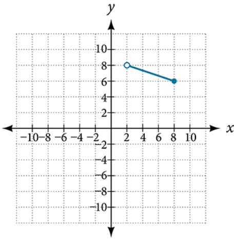

# AVP0912 — Single visual target

VisioMath:1452_A / MathVerse:482 · same type · Mathematical roles of graphical elements

[Left image in official archive](https://raw.githubusercontent.com/Nefefilibata/VisioMath/4a912153e110001da261917902e1d3cc163b7c6a/data/images.zip) · `images/1452_A.jpg`

## Shared or similar visual information

A hollow circular marker interrupting or ending a graph trace.

## Evidence locations

- Left image: The hollow circle at the right endpoint of the broken line.
- Right image: The hollow endpoint on the upper left of the blue segment.

## Mathematical meanings

Left image: An open point excluded from the displayed curve or branch. Right image: An open point excluded from the displayed curve or branch.

## Same mathematical meanings

yes

## Rationales

Each hollow mark excludes its indicated point from the drawn branch. This conclusion concerns the individual point, so it does not require the same horizontal or vertical coordinates across the diagrams.

Only the selected target is annotated. AI visual-review draft; not independently double-annotated by humans.
