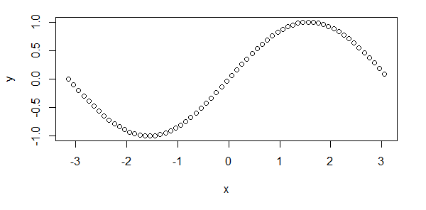

# AVP0913 — Single visual target

MathVista:118 / VisioMath:1563_A · same type · Mathematical roles of graphical elements

[Right image in official archive](https://raw.githubusercontent.com/Nefefilibata/VisioMath/4a912153e110001da261917902e1d3cc163b7c6a/data/images.zip) · `images/1563_A.jpg`

## Shared or similar visual information

Small hollow circular plotting symbols.

## Evidence locations

- Left image: One of the hollow circles at the crest of the dotted oscillating trace.
- Right image: The hollow circle at the endpoint near x=2 on the horizontal axis.

## Mathematical meanings

Left image: A visible position in a mathematical sequence plotted with hollow point glyphs. Right image: An open point excluded from the displayed curve or branch.

## Same mathematical meanings

no

## Rationales

The open circle attached to a branch endpoint excludes that coordinate pair. The hollow circles repeated throughout the other trace are the visible plotting marks for sampled positions.

Only the selected target is annotated. AI visual-review draft; not independently double-annotated by humans.
