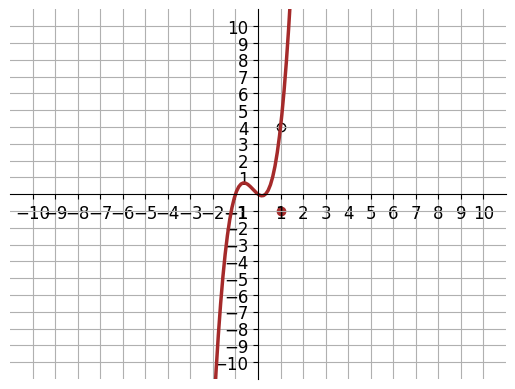

# AVP0916 — Single visual target

DynaMath:102 / VisioMath:311_A · different type · Mathematical roles of graphical elements

[Right image in official archive](https://raw.githubusercontent.com/Nefefilibata/VisioMath/4a912153e110001da261917902e1d3cc163b7c6a/data/images.zip) · `images/311_A.jpg`

## Shared or similar visual information

An unfilled circular outline.

## Evidence locations

- Left image: The hollow marker on the red curve at x=2, above the solid point on the horizontal axis.
- Right image: The white circular opening inside the shaded parallelogram.

## Mathematical meanings

Left image: An open point excluded from the displayed curve or branch. Right image: The actual circumference of a circle within a finite geometric construction.

## Same mathematical meanings

no

## Rationales

The little outline at the graph boundary identifies one omitted coordinate pair. The larger circle is itself a geometric boundary made up of positions on a circumference.

Only the selected target is annotated. AI visual-review draft; not independently double-annotated by humans.
