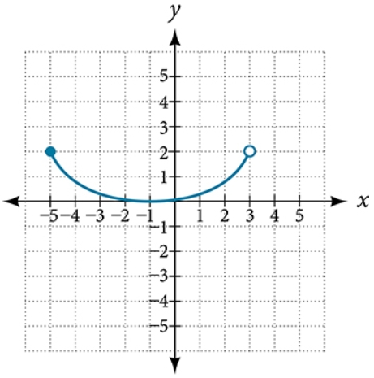

# AVP0917 — Single visual target

VisioMath:335_A / MathVerse:484 · different type · Mathematical roles of graphical elements

[Left image in official archive](https://raw.githubusercontent.com/Nefefilibata/VisioMath/4a912153e110001da261917902e1d3cc163b7c6a/data/images.zip) · `images/335_A.jpg`

## Shared or similar visual information

An unfilled circular outline.

## Evidence locations

- Left image: The unfilled circular boundary inside the hatched triangle.
- Right image: The hollow endpoint on the right end of the blue U-shaped curve.

## Mathematical meanings

Left image: The actual circumference of a circle within a finite geometric construction. Right image: An open point excluded from the displayed curve or branch.

## Same mathematical meanings

no

## Rationales

The little outline at the graph boundary identifies one omitted coordinate pair. The larger circle is itself a geometric boundary made up of positions on a circumference.

Only the selected target is annotated. AI visual-review draft; not independently double-annotated by humans.
