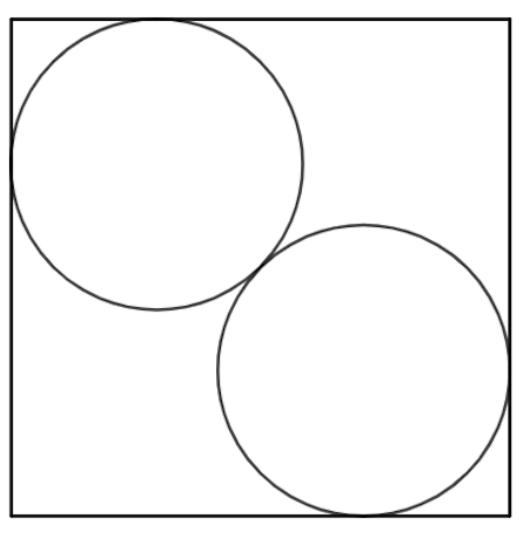

# AVP0919 — Single visual target

DynaMath:107 / VisioMath:1452_A · different type · Mathematical roles of graphical elements

[Right image in official archive](https://raw.githubusercontent.com/Nefefilibata/VisioMath/4a912153e110001da261917902e1d3cc163b7c6a/data/images.zip) · `images/1452_A.jpg`

## Shared or similar visual information

An unfilled circular outline.

## Evidence locations

- Left image: The circular outline at the top-left of the square.
- Right image: The hollow circle at the right endpoint of the broken line.

## Mathematical meanings

Left image: The actual circumference of a circle within a finite geometric construction. Right image: An open point excluded from the displayed curve or branch.

## Same mathematical meanings

no

## Rationales

The little outline at the graph boundary identifies one omitted coordinate pair. The larger circle is itself a geometric boundary made up of positions on a circumference.

Only the selected target is annotated. AI visual-review draft; not independently double-annotated by humans.
