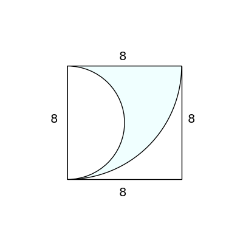

# AVP0923 — Single visual target

DynaMath:112 / VisioMath:174_A · same type · Mathematical roles of graphical elements

[Right image in official archive](https://raw.githubusercontent.com/Nefefilibata/VisioMath/4a912153e110001da261917902e1d3cc163b7c6a/data/images.zip) · `images/174_A.jpg`

## Shared or similar visual information

A bounded geometric patch selected with shading or hatching.

## Evidence locations

- Left image: The pale-blue curved part inside the square between two arcs.
- Right image: The shaded large lower-right rectangle inside the partitioned outer rectangle.

## Mathematical meanings

Left image: A selected plane region distinguished by shading within a geometric construction. Right image: A selected plane region distinguished by shading within a geometric construction.

## Same mathematical meanings

yes

## Rationales

In both diagrams the fill selects a bounded planar part of a larger geometric construction. Its extent follows the visible object boundaries rather than coordinate values or a chart legend.

Only the selected target is annotated. AI visual-review draft; not independently double-annotated by humans.
