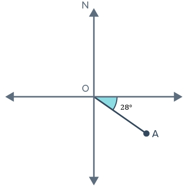

# AVP0928 — Single visual target

VisioMath:539_A / MathVerse:334 · same type · Mathematical roles of graphical elements

[Left image in official archive](https://raw.githubusercontent.com/Nefefilibata/VisioMath/4a912153e110001da261917902e1d3cc163b7c6a/data/images.zip) · `images/539_A.jpg`

## Shared or similar visual information

A dark or colored filled region near geometric boundaries.

## Evidence locations

- Left image: The shaded triangular part above the tilted inner square.
- Right image: The turquoise wedge adjacent to 28 degrees at O.

## Mathematical meanings

Left image: A selected plane region distinguished by shading within a geometric construction. Right image: A wedge that selects the particular angle annotated in degrees.

## Same mathematical meanings

no

## Rationales

One filled patch selects a planar subregion through the object’s boundaries. The wedge between two rays is attached to a degree label and identifies an angle.

Only the selected target is annotated. AI visual-review draft; not independently double-annotated by humans.
