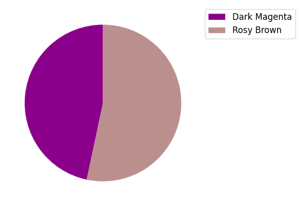

# AVP0930 — Single visual target

VisioMath:598_A / DynaMath:5 · different type · Mathematical roles of graphical elements

[Left image in official archive](https://raw.githubusercontent.com/Nefefilibata/VisioMath/4a912153e110001da261917902e1d3cc163b7c6a/data/images.zip) · `images/598_A.jpg`

## Shared or similar visual information

A filled portion bounded partly by a circular arc.

## Evidence locations

- Left image: The shaded curved lobe beside a side of the inscribed triangle.
- Right image: The dark magenta sector associated with the legend entry Dark Magenta.

## Mathematical meanings

Left image: A selected plane region distinguished by shading within a geometric construction. Right image: A sector of a pie chart whose proportion encodes a labeled category’s share of the total.

## Same mathematical meanings

no

## Rationales

The geometry fill identifies a region through its arcs and other boundaries. The pie chart fill is keyed to a category and its fraction of a whole.

Only the selected target is annotated. AI visual-review draft; not independently double-annotated by humans.
