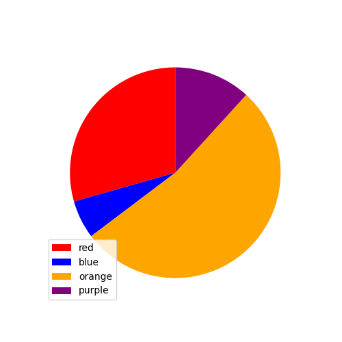

# AVP0931 — Single visual target

DynaMath:30 / VisioMath:311_A · different type · Mathematical roles of graphical elements

[Right image in official archive](https://raw.githubusercontent.com/Nefefilibata/VisioMath/4a912153e110001da261917902e1d3cc163b7c6a/data/images.zip) · `images/311_A.jpg`

## Shared or similar visual information

A filled portion bounded partly by a circular arc.

## Evidence locations

- Left image: The orange sector corresponding to the legend’s orange category.
- Right image: The gray part of the parallelogram surrounding its unfilled circle.

## Mathematical meanings

Left image: A sector of a pie chart whose proportion encodes a labeled category’s share of the total. Right image: A selected plane region distinguished by shading within a geometric construction.

## Same mathematical meanings

no

## Rationales

The geometry fill identifies a region through its arcs and other boundaries. The pie chart fill is keyed to a category and its fraction of a whole.

Only the selected target is annotated. AI visual-review draft; not independently double-annotated by humans.
