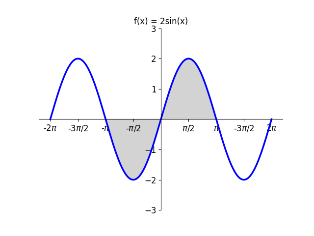

# AVP0932 — Single visual target

VisioMath:1405_A / DynaMath:77 · different type · Mathematical roles of graphical elements

[Left image in official archive](https://raw.githubusercontent.com/Nefefilibata/VisioMath/4a912153e110001da261917902e1d3cc163b7c6a/data/images.zip) · `images/1405_A.jpg`

## Shared or similar visual information

A filled patch in a mathematical diagram.

## Evidence locations

- Left image: The filled upper-right cell in the four-by-four square grid.
- Right image: The gray filled lobe between the sine graph and the horizontal axis just right of the vertical axis.

## Mathematical meanings

Left image: A selected cell in a discrete pattern of filled and unfilled grid squares. Right image: A continuous area between a function trace and the horizontal axis.

## Same mathematical meanings

no

## Rationales

The square fill selects one unit cell of a discrete pattern. The continuous graph fill occupies an interval between a curve and an axis.

Only the selected target is annotated. AI visual-review draft; not independently double-annotated by humans.
