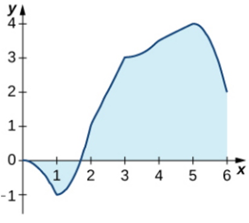

# AVP0933 — Single visual target

MathVista:260 / VisioMath:1506_A · different type · Mathematical roles of graphical elements

[Right image in official archive](https://raw.githubusercontent.com/Nefefilibata/VisioMath/4a912153e110001da261917902e1d3cc163b7c6a/data/images.zip) · `images/1506_A.jpg`

## Shared or similar visual information

A filled patch in a mathematical diagram.

## Evidence locations

- Left image: The light blue filled region between the graph and the horizontal axis to the right of the positive zero.
- Right image: The shaded cell at the top end of the diagonal staircase pattern.

## Mathematical meanings

Left image: A continuous area between a function trace and the horizontal axis. Right image: A selected cell in a discrete pattern of filled and unfilled grid squares.

## Same mathematical meanings

no

## Rationales

The square fill selects one unit cell of a discrete pattern. The continuous graph fill occupies an interval between a curve and an axis.

Only the selected target is annotated. AI visual-review draft; not independently double-annotated by humans.
