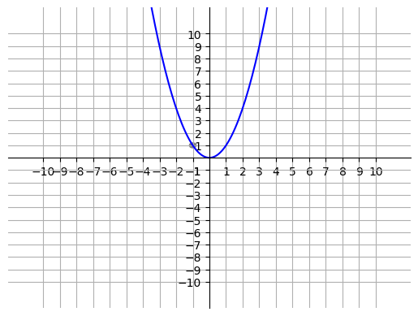

# AVP0937 — Single visual target

DynaMath:46 / VisioMath:16_A · same type · Mathematical roles of graphical elements

[Right image in official archive](https://raw.githubusercontent.com/Nefefilibata/VisioMath/4a912153e110001da261917902e1d3cc163b7c6a/data/images.zip) · `images/16_A.jpg`

## Shared or similar visual information

A smooth main trace plotted against horizontal and vertical axes.

## Evidence locations

- Left image: The blue U-shaped graph on the grid with its low point on the horizontal axis.
- Right image: The U-shaped curve with its bottom on the horizontal axis near -1.

## Mathematical meanings

Left image: A plotted trace whose height gives an output for each horizontal input on the shown part. Right image: A plotted trace whose height gives an output for each horizontal input on the shown part.

## Same mathematical meanings

yes

## Rationales

Both traces use horizontal positions as inputs and vertical positions as outputs. The displayed function role is shared across different curve shapes and scales.

Only the selected target is annotated. AI visual-review draft; not independently double-annotated by humans.
