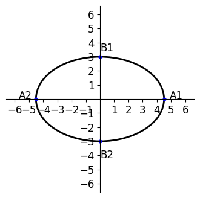

# AVP0945 — Single visual target

DynaMath:175 / VisioMath:1187_A · different type · Mathematical roles of graphical elements

[Right image in official archive](https://raw.githubusercontent.com/Nefefilibata/VisioMath/4a912153e110001da261917902e1d3cc163b7c6a/data/images.zip) · `images/1187_A.jpg`

## Shared or similar visual information

A smooth curved stroke.

## Evidence locations

- Left image: The black ellipse with four named axis endpoints.
- Right image: The smooth wave extending between the -π and π ticks.

## Mathematical meanings

Left image: A curved boundary of a finite geometric figure. Right image: A plotted trace whose height gives an output for each horizontal input on the shown part.

## Same mathematical meanings

no

## Rationales

The plotted trace gives outputs along a horizontal scale. The curved boundary encloses or delimits a finite geometric figure, as shown by the surrounding construction.

Only the selected target is annotated. AI visual-review draft; not independently double-annotated by humans.
