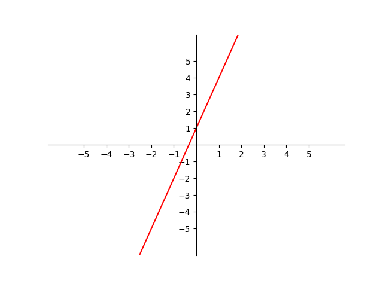

# AVP0948 — Single visual target

VisioMath:107_A / DynaMath:15 · same type · Mathematical roles of graphical elements

[Left image in official archive](https://raw.githubusercontent.com/Nefefilibata/VisioMath/4a912153e110001da261917902e1d3cc163b7c6a/data/images.zip) · `images/107_A.jpg`

## Shared or similar visual information

A sloping straight trace on a coordinate system.

## Evidence locations

- Left image: The upward-sloping line crossing both Cartesian axes.
- Right image: The red ascending straight trace crossing the numbered coordinate axes.

## Mathematical meanings

Left image: A sloping straight graph encoding a constant rate of change of output with input. Right image: A sloping straight graph encoding a constant rate of change of output with input.

## Same mathematical meanings

yes

## Rationales

Each straight trace plots output against input with constant slope. The visible axes separate this plotted role from a straight edge of an object.

Only the selected target is annotated. AI visual-review draft; not independently double-annotated by humans.
