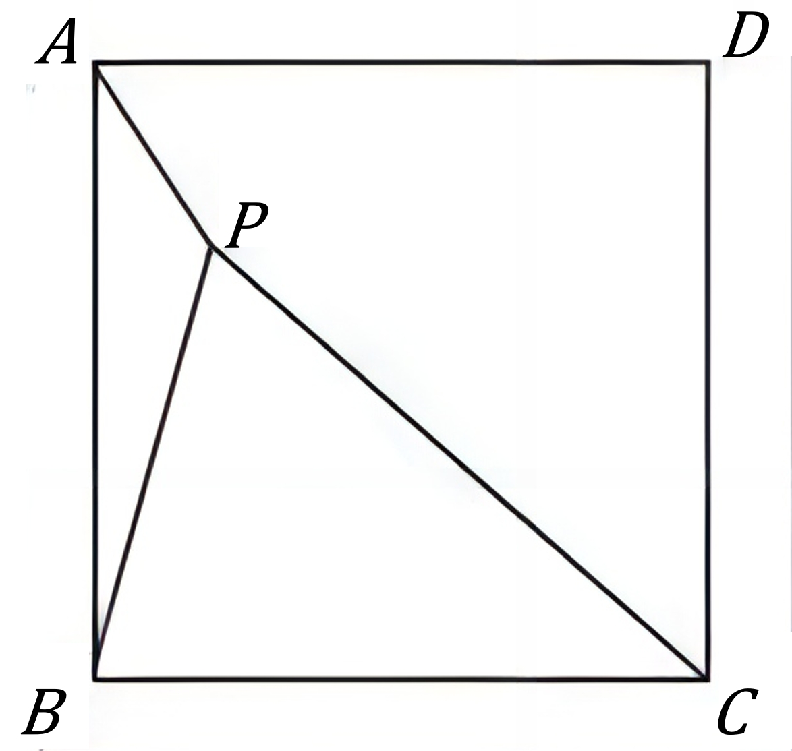

# AVP0953 — Single visual target

DynaMath:145 / VisioMath:1168_A · same type · Mathematical roles of graphical elements

[Right image in official archive](https://raw.githubusercontent.com/Nefefilibata/VisioMath/4a912153e110001da261917902e1d3cc163b7c6a/data/images.zip) · `images/1168_A.jpg`

## Shared or similar visual information

A straight segment joining opposite corners of a four-sided figure.

## Evidence locations

- Left image: The diagonal AC crossing the interior of the square.
- Right image: The solid line from the upper-left to the lower-right rectangle corner.

## Mathematical meanings

Left image: A diagonal connecting opposite vertices inside a quadrilateral. Right image: A diagonal connecting opposite vertices inside a quadrilateral.

## Same mathematical meanings

yes

## Rationales

Each selected segment lies inside its quadrilateral and joins nonadjacent vertices, identifying the same diagonal role.

Only the selected target is annotated. AI visual-review draft; not independently double-annotated by humans.
