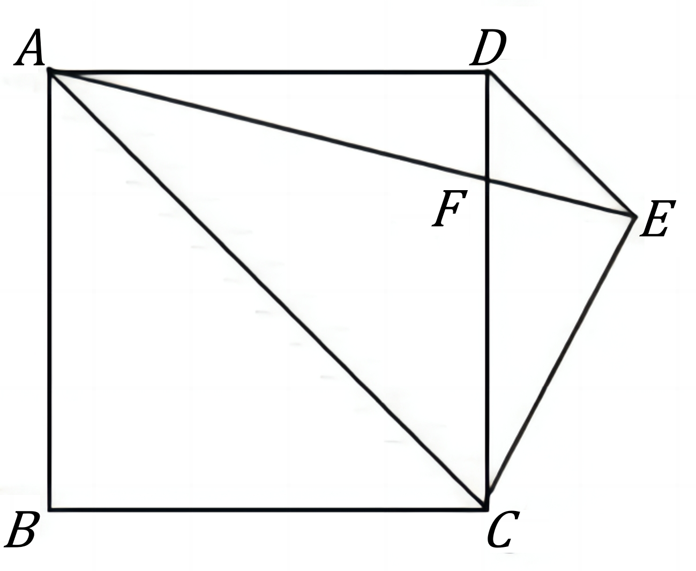
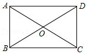

# AVP0954 — Single visual target

DynaMath:167 / MathVista:585 · same type · Mathematical roles of graphical elements

## Shared or similar visual information

A straight segment joining opposite corners of a four-sided figure.

## Evidence locations

- Left image: The diagonal AC inside quadrilateral ABCD.
- Right image: The diagonal AC passing through O in the rectangle.

## Mathematical meanings

Left image: A diagonal connecting opposite vertices inside a quadrilateral. Right image: A diagonal connecting opposite vertices inside a quadrilateral.

## Same mathematical meanings

yes

## Rationales

Each selected segment lies inside its quadrilateral and joins nonadjacent vertices, identifying the same diagonal role.

Only the selected target is annotated. AI visual-review draft; not independently double-annotated by humans.
