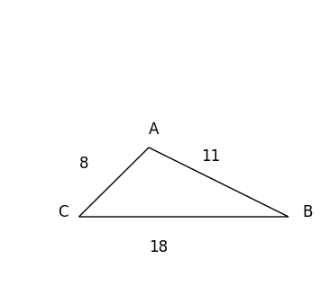

# AVP0959 — Single visual target

DynaMath:206 / VisioMath:643_A · different type · Mathematical roles of graphical elements

[Right image in official archive](https://raw.githubusercontent.com/Nefefilibata/VisioMath/4a912153e110001da261917902e1d3cc163b7c6a/data/images.zip) · `images/643_A.jpg`

## Shared or similar visual information

A solid sloping line.

## Evidence locations

- Left image: The sloping triangle side from A down to B, beside the label 11.
- Right image: The black descending straight trace on the coordinate axes.

## Mathematical meanings

Left image: A sloping outer side of a finite geometric figure. Right image: A sloping straight graph encoding a constant rate of change of output with input.

## Same mathematical meanings

no

## Rationales

The straight trace crosses coordinate axes to give a relationship between variables. The finite side joins vertices of a closed geometric figure.

Only the selected target is annotated. AI visual-review draft; not independently double-annotated by humans.
